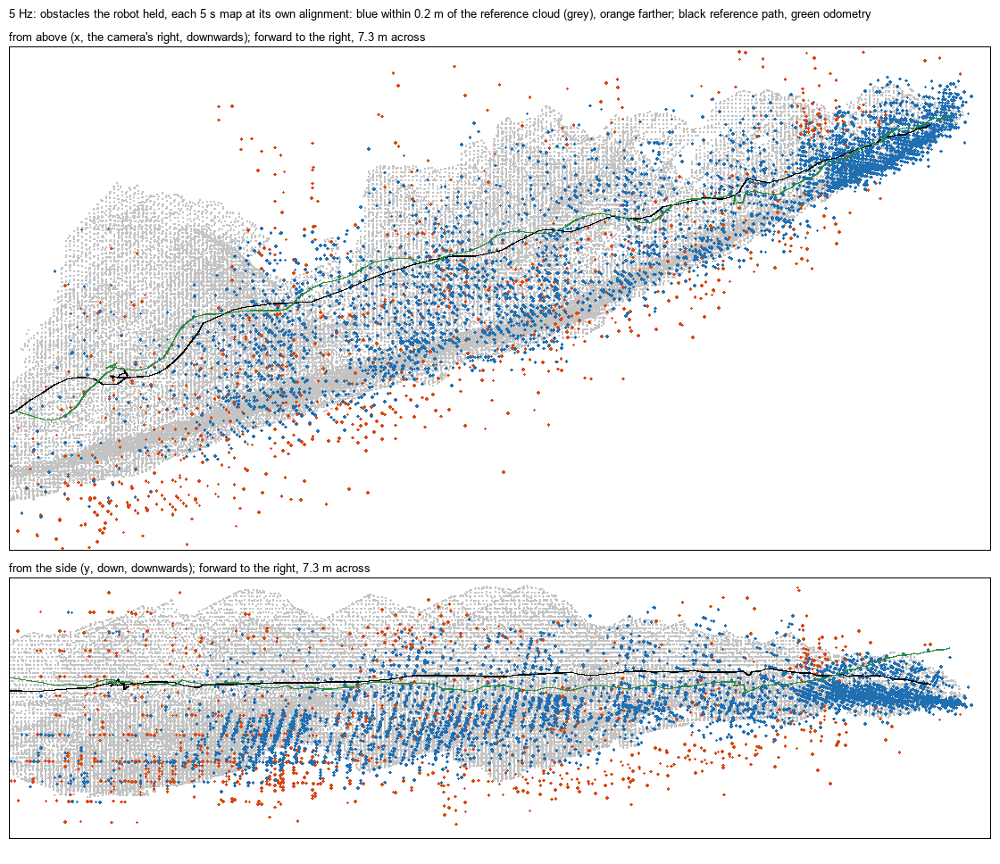
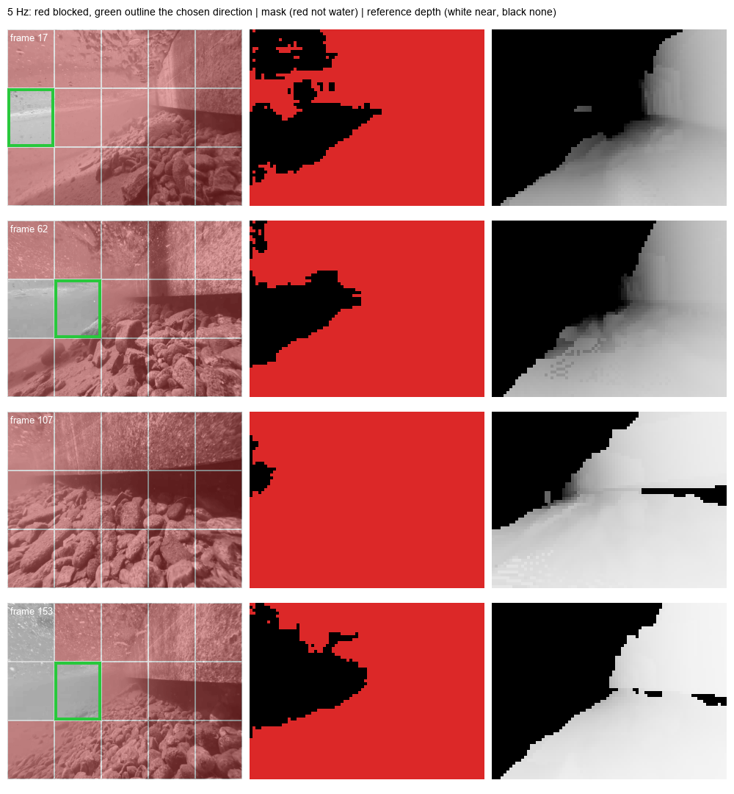
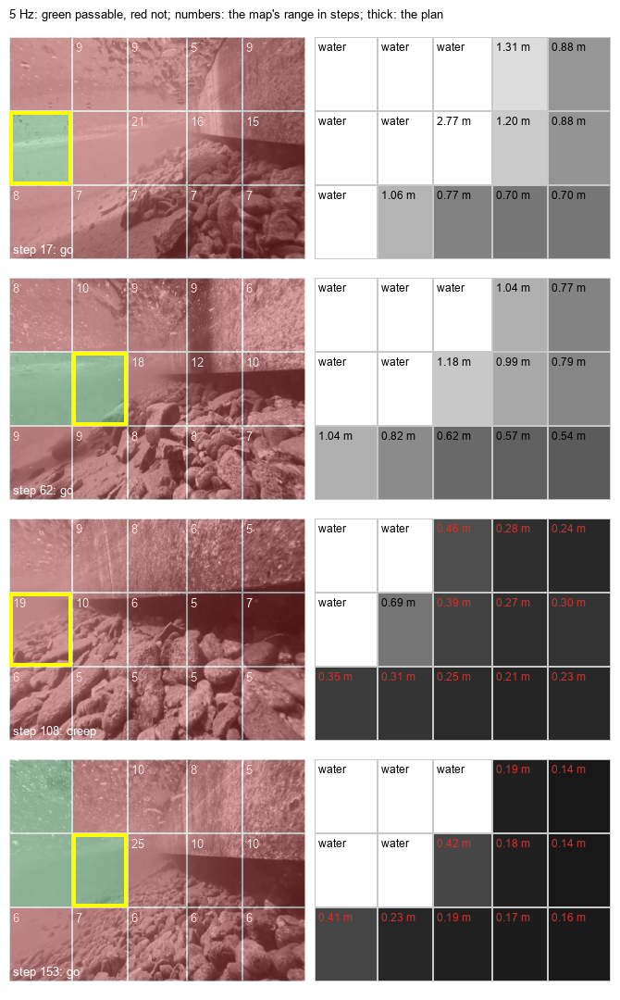

# uwslam

Monocular-camera SLAM for a small underwater robot: one camera, no IMU or rangers. A C core that gives the same results
bit for bit on a PC and on an ESP32-S3 turns the robot camera's grey frames into the camera's motion and a continuing
3D map, turns the segmentation model's water mask into the directions of the view that are blocked, and from both
plans where to head next. Everything is checked on a lake clip against a 3D reconstruction of it, and on an ESP32-S3 by
streaming the clip to the board over USB.

[中文说明](README.zh-CN.md)

```text
camera frame, 320×240 grey
├── core/mono_vo        corners, Lucas-Kanade tracking, the camera's motion, triangulated sparse points
│   └── core/voxel_map      the points accumulated in a 3D voxel map that goes on through tracking losses ──┐
│                                                                                                         ├─ core/path_plan
└── segmentation model (ESP-DL, outside this repository): 60×80 water / not-water mask                    │  where to head next:
    └── core/obstacle_dir   which directions of the view are blocked, and the free one nearest ahead ─────┘  avoidance in 3D
```

Two older maps stay beside them: [core/mono_map](core/mono_map.h), a top-view obstacle slice, and
[core/mono_cloud](core/mono_cloud.h), the tracked features' sparse points. Both freeze at the first tracking loss.

## Findings

All numbers come from the lake clip: the first 33.8 s of an underwater video filmed along a wall in a lake, at 30 FPS.
The reference is a WaterSplat reconstruction of it: 88 camera poses (their stamps times 3, see
[mask_motion](results/lake_clip/mask_motion/RESULTS.md)) and 4.6 million points, taken as metres. The water masks are
the segmentation model's output on the robot camera's 160×120 frames. Medians are over 16 RANSAC seeds, because on this
clip the seed alone can change an error twofold.

1. **The odometry tracks the clip at the board's rates.** The C port's camera path, after one similarity alignment, is
   0.33 m RMSE at 10 Hz, 0.33 m at 5 Hz and 0.42 m at 3 Hz over the 8.9 m the camera swims. The OpenCV prototype it was
   ported from gives 0.41, 0.44 and 0.33 m on one seed. Tracking is lost on 2, 11 and 21 steps. The monocular scale
   drifts: the largest over the smallest 5 s window ratio is 5.3×, 2.6× and 9.1×. The estimated pitch drifts upward,
   35° over the clip at 5 Hz, so a path lined up at the start climbs where the camera swam level.
2. **The 3D map goes on for the whole clip.** The voxel map holds what the robot needs around it: every 5 s, the
   obstacles it holds lie a median 5.5 cm (10 Hz) and 6.1 cm (5 Hz) from the reconstruction's surfaces, and 84% and 80%
   of them lie within 0.2 m. That is with the last 5 s of the path aligned to the reference. With one alignment for the
   whole drifting path it is 0.10 m and 0.16 m. It goes on through every tracking loss. The older maps, frozen at the
   first loss, stop after 4.3–4.4 s of the 33.8 s.
3. **The water mask tells the blocked directions reliably.** When the reconstruction has a surface within 0.5, 1 or
   2 m filling half of one of the 15 directions, the mask blocks that direction too, in at least 99% of the cases in
   every band. The direction it picks as free
   really is free 100%, 100% and 99% of the time at those ranges. Straight ahead is free only 87%, 61% and 19% of the
   time, and a random direction 65%, 45% and 40%. The mask also blocks the water surface above, which the
   reconstruction lacks.
4. **The planner heads into free water and knows how far it is.** Going, it heads into a corridor free beyond 0.5 m in
   97% of its steps and beyond 1 m in 93%, never into one blocked within 0.25 m, where straight ahead is free beyond 1 m
   in only 51%. Where the mask sees no free direction (3–4% of the steps, facing the wall) it creeps into the free water
   the map knows instead of having no answer. Its ranges, counted in steps of the robot's own speed, agree with the
   reference's within a factor of 2 for 85–91% of the directions the map knows. Where the mask sees water the map holds
   no points, so the plan bounds those directions by the surfaces in view instead: free for a median 9.5 steps at 5 Hz
   (15.6 at 10 Hz), and the reference was nearer than that bound in at most 1% of the water directions.
5. **The ESP32-S3 gives the PC's results, at 5 Hz.** With the clip streamed at 5 and 10 Hz, the board gives every
   odometry step, the voxel map, the directions, the plan and the obstacle map exactly as the PC does. At 240 MHz on two
   cores a 5 Hz step takes 161 ms (median 169, at most 207); the voxel map adds 1.0 ms, the directions 0.25 ms and the
   plan 1.2 ms, within the 200 ms between frames. At 10 Hz a step takes 135 ms, more than the 100 ms between frames.
   12 KB of internal RAM stays free. An ESP32-P4 at 360 MHz gives the same results with its own vector kernels: a 5 Hz
   step in 74 ms (at most 96), and at 10 Hz every step within the 100 ms between frames.

## Repository layout

```text
.
├── core/                       C99, no heap, no libm
│   ├── mono_vo*.c, mono_vo.h   monocular visual odometry (five units, see mono_vo_internal.h)
│   ├── voxel_map.c/.h          the continuing 3D voxel map
│   ├── obstacle_dir.c/.h       blocked directions from the water mask
│   ├── path_plan.c/.h          where to head next: local avoidance and 3D path choice
│   ├── mono_map.c/.h           top-view obstacle slice (frozen at the first loss)
│   └── mono_cloud.c/.h         sparse points of the tracked features (frozen at the first loss)
├── firmware/esp32s3_mono_vo/   ESP-IDF app (ESP32-S3, also ESP32-P4): runs the core on streamed frames and masks, reports hashes and times
├── src/uwslam/                 Python package
│   ├── mvo.py                  ctypes binding of the core; the odometry on the lake clip against the OpenCV prototype
│   ├── voxel_map.py            the voxel map on the lake clip, scored against the reconstruction
│   ├── obstacle_dir.py         the directions on the lake clip, scored against the reconstruction's depth
│   ├── path_plan.py            the plan on the lake clip, scored against the reconstruction's free corridors
│   ├── mono_map.py, mono_cloud.py   the older maps
│   ├── mvo_stream.py           streams frames and masks to the board and checks every step against the PC
│   └── experiments/            the OpenCV prototype (mono_vo), the reference poses and masks (mask_motion), the
│                               segmentation model runner (segmenter)
├── tests/                      unittest suite; tests/c/ holds the C contract checks and firmware host harnesses
├── results/lake_clip/          reference results, one folder per tool, each with RESULTS.md
└── results/lake_clip_p4/       the results of the tools that build the core, in the p4 configuration (UWSLAM_CONFIG=p4)
```

## Getting started

Needs Python 3.10 or newer and gcc on the PATH (MinGW-w64 on Windows): the C core is compiled into a shared library on
the fly. Run everything from the repository root.

```bash
pip install -e ".[experiments]"             # numpy, Pillow, OpenCV (torch and esp-ppq only for the segmenter)
python -m unittest discover -s tests -t .
```

The lake clip and its reconstruction are not part of the repository. The tools take the video and a reconstruction
folder holding `images.txt` (camera poses, TUM format) and `images.ply` (point cloud). Every tool refuses to overwrite
an existing output; choose a fresh folder.

```bash
python -m uwslam.mvo compare <video> --reconstruction <folder> --output results/lake_clip/mono_vo_c_2 --board-frames <frames file>
python -m uwslam.voxel_map <video> --reconstruction <folder> --output results/lake_clip/voxel_map_2
python -m uwslam.obstacle_dir <video> --reconstruction <folder> --output results/lake_clip/obstacle_dir_2
python -m uwslam.path_plan <video> --reconstruction <folder> --output results/lake_clip/path_plan_2
python -m uwslam.mono_map <video> --reconstruction <folder> --output results/lake_clip/mono_map_2 --board-masks <masks file>
```

The core has two build configurations ([core/mono_vo.h](core/mono_vo.h)): `s3`, the default, and `p4` for the
ESP32-P4 (300 features instead of 250; see ESP32-P4 below). The tools and tests build the one the `UWSLAM_CONFIG`
environment variable names, `s3` when it is unset, and record it in their outputs.

The water masks come from [mask_motion](src/uwslam/experiments/mask_motion.py), which runs an exported ESP-DL int8
segmentation model on the clip ([segmenter.py](src/uwslam/experiments/segmenter.py) describes the model folder).

## Monocular odometry

[core/mono_vo.h](core/mono_vo.h) tracks up to 250 Shi-Tomasi corners (300 in the p4 configuration) with a fixed-point
pyramidal Lucas-Kanade and a forward-backward check. When the tracks fit a pure turn (a homography within 1 px), the step is that rotation.
Otherwise an eight-point MSAC essential matrix, a search over travel directions and a robust Levenberg-Marquardt
give the motion, unless a separately fitted rotation explains the tracks as well. A fast turn adds a pull towards the
homography's turn. Translation is accepted only when the evidence favours it. The step length comes from the depth
ratios of the points two steps share, kept within three times the recent speed. A step with too few inliers is LOST:
it keeps the position, takes the turn it can measure and, where its depths agree with the earlier points', carries the
scale on. The C port follows the OpenCV prototype
([experiments/mono_vo.py](src/uwslam/experiments/mono_vo.py)) in design, not in numbers; the comparison of the two is
[results/lake_clip/mono_vo_c/RESULTS.md](results/lake_clip/mono_vo_c/RESULTS.md), the prototype's own run
[results/lake_clip/mono_vo/RESULTS.md](results/lake_clip/mono_vo/RESULTS.md).

| Rate | Position RMSE after alignment | Heading RMSE | Scale spread over 5 s windows | Lost steps |
|---:|---:|---:|---:|---:|
| 10 Hz | 0.33 m [0.26–0.38] | 34.2° [26–39] | 5.3× [1.7–11.1] | 2 [1–5] |
| 5 Hz | 0.33 m [0.24–0.45] | 18.3° [9–25] | 2.6× [1.4–7.4] | 11 [9–14] |
| 3 Hz | 0.42 m [0.38–0.54] | 27.1° [8–43] | 9.1× [6.6–11.1] | 21 [19–23] |

Median [smallest–largest] over 16 seeds. A monocular run has no metric scale: the alignment supplies it.

The 5 Hz path climbs because the estimated pitch drifts upward, not because the travel points up: with the reference's
orientation and the odometry's directions of travel it ends level with the reference. Part of the drift came from LOST
steps on fast turns. Where only the homography, not the separately fitted rotation, has the support, the homography has
mostly read the travel's parallax as a turn, over the lake's floor as pitch: on such lost steps at 5 Hz it errs +1.5°
in pitch a step against −0.2° for the essential pose, though by as much in all (6.0° and 6.2°), and the bias adds up.
Such a step now takes the essential pose's rotation when that had 15 inliers,
still without a translation. Over 16 seeds the end pitch error fell from 46° to 35° at 5 Hz and from 47° to 20° at
3 Hz, and over 10 s windows the orientation error from 14° to 13° and from 26° to 15°; 10 Hz, with 2 lost steps,
changes little. (The heading RMSE over the whole clip is one realisation of a random walk and moved by a few degrees
either way.) Lost steps with no supported rotation still keep none: on a still camera with noisy tracks the essential
pose's rotation would add turns of 30° and more. The rest of the drift, about +0.18° of pitch per essential step (28°
over the clip at 5 Hz), OpenCV's five-point solver on full-resolution SIFT matches shows too; its cause lies in the
short-baseline tracks and is still open.

Translation is refused on about 15 steps a run at 5 Hz, mostly on fast turns, and rightly: there the directions of
travel the essential matrix proposed lie a median 87–126° from the reference's, against 10–11° for the steps it accepted
on turns as fast. What those steps cost was the scale. A LOST step dropped the triangulated points that carry the step
length from one step to the next, so each time the next step restarted at the recent speed, and the scale jumped by 1.4
times across them in the median. Now a lost step whose essential pose had 15 inliers carries its points on with that
pose, still taking no translation, when at least 8 of the depth ratios it shares with the earlier points agree on one
scale (their interquartile range at most half their median). Over 16 seeds the 5 Hz path came out 0.33 m off instead of
0.40 m, and the scale spread fell from 5.8× to 2.6×. Over 10 s windows it is unchanged (0.079 m against 0.077 m: equal
in 57% of 192 paired runs, lower in 20%); the voxel map's local accuracy at 5 Hz went from 5.7 to 6.1 cm and its
accuracy over the whole path from 0.19 to 0.16 m; 10 Hz came out 0.33 m instead of 0.31 m. A still camera's noise fits
poses whose depth ratios scatter, so it nearly always drops its points: none of 43,200 still or turning steps took a
translation, and after one to three noisy hovers the next move's length was off by more than 23% in 0.2–0.6% of the
trials. A first version also carried points without shared ones when they showed 2° of parallax; after two noisy
hovers that put the next move's length off by more than 23% in a quarter to two fifths of the trials.

The camera is `mvo_camera_t`: the 320×240 frame's pinhole intrinsics and its lens distortion in OpenCV's model and
order, k1, k2, p1, p2 and k3, as `cv2.calibrateCamera` gives them for a calibration at 320×240. Calibrate the robot's
camera under water, behind its port: the water and a flat port change the lens. Before any model sees a step's pairs,
the core undistorts them by Newton steps, which agree with OpenCV's undistortion to within 0.0001 px on the test
lenses. The corners, the tracking and the masks stay in the raw image, and the obstacle directions take each mask
column's and row's undistorted ray. With all five zero, as on the lake clip, whose lens is unknown, nothing changes:
every result here is bit-identical to the pinhole core's. On frames rendered through a strong barrel lens, the odometry
erred per step by at most 0.06° in turn and 0.7° in the direction of travel when told the lens, and by 2.8° and 11°
when it took the same frames for a pinhole's. On the board, a run with all five terms non-zero matched the PC on all
248 odometry steps and the sparse cloud, and cost at most about 1 ms a step: on the same frames motion estimation took
54 against 53 ms, the whole step 161 against 160 ms. From Python: `mvo.Camera(fx, fy, cx, cy, k1, k2, p1, p2, k3)`, or
`python -m uwslam.mono_cloud <video> --fx … --k1 … --k3 …`; the board's `start` line carries the five at its end,
after the seed, cores and simd.

## Continuing voxel map

[core/voxel_map.h](core/voxel_map.h) files, after every odometry step, the well-triangulated tracked points that the
mask marks as not water, voxel by voxel, in the odometry's frame. It goes on through LOST steps, since the odometry
keeps its frame through them. The monocular unit drifts, so the voxel side follows the scene: an eighth of the median
depth. It is reset, and the voxels re-keyed and merged, when the scene asks for twice or half the current side. A voxel
seen in two frames is an obstacle; unobserved space is unknown, not free. The map holds at most 1024 voxels (14 KB).
When it is full, far voxels make room first, then voxels seen only once, then the obstacles unseen longest. At 5 Hz on
the lake clip that keeps the last 4 s of obstacles (median; 90% within 8 s).

| Rate | Local: median distance | Local: within 0.1 / 0.2 m | Global: median distance | Obstacles held | LOST steps gone through |
|---:|---:|---:|---:|---:|---:|
| 10 Hz | 0.055 m [0.052–0.062] | 68% / 84% | 0.10 m [0.05–0.16] | 876 | 2 |
| 5 Hz | 0.061 m [0.048–0.083] | 64% / 80% | 0.16 m [0.09–0.28] | 717 | 11 |

Local: every 5 s, the obstacles the robot holds, with the last 5 s of its path aligned to the reference (what avoidance
uses). Global: the obstacles held at the end, with one alignment of the whole path. Details and figures:
[results/lake_clip/voxel_map/RESULTS.md](results/lake_clip/voxel_map/RESULTS.md).



## Obstacle directions

[core/obstacle_dir.h](core/obstacle_dir.h) splits each frame's 60×80 mask into 3 × 5 directions of the camera's view:
bands up, level and down at ±15°, and sectors at ±15° and ±40° from the optical axis. A direction is blocked as soon as
half of it is not water, and freed only after two frames below 30%. The choice is the free direction nearest straight
ahead: fewest steps first, then turning before rising or diving, then the more open one. It is scored against the
reconstruction seen through the same grid from each frame's reference camera.
[results/lake_clip/obstacle_dir/RESULTS.md](results/lake_clip/obstacle_dir/RESULTS.md) has the tables per band and
range.



The mask gives direction, not range, and "up" is the image's up, not gravity's. The voxel map gives the ranges, and the
planner joins the two.

## Avoidance and path choice

[core/path_plan.h](core/path_plan.h) decides after every step where to head, among the same 3 × 5 directions, towards a
goal direction (straight ahead unless the caller gives one in the odometry's world). A single camera fixes no scale, so
ranges count in steps: the odometry's recent speed is one step, and a range of n steps is n frames away at that speed.
A direction's range is the distance to the second nearest obstacle voxel in it (one alone is too easily an outlier). A
direction is passable when the mask shows it free and the map puts no obstacle within 8 steps (1.6 s at 5 Hz) there.
The map adds vetoes but lifts none: it holds only textured points, and where it holds none the mask may still see a
surface. Letting a far map range reopen a direction the mask blocked sent the plan into corridors blocked within 0.25 m
in 2–4% of its steps; without it, in none. The plan heads for the passable direction nearest the goal, turning before
rising or diving. With none passable it creeps into the longest free water the map knows (at least 3 steps), else turns
in place away from the side where the map holds more obstacles, and with nothing known it stops.

It is scored open-loop (the camera follows the diver, not the plan) against each direction's free corridor in the
reconstruction: the 10th percentile range over the central half of the direction's cells.

| 5 Hz, 16 seeds | Free beyond 0.25 m | Free beyond 0.5 m | Free beyond 1 m |
|---|---:|---:|---:|
| The plan, going (96% of the steps) | 100% | 97% | 93% |
| The plan, creeping (4% of the steps, where the mask sees no free direction) | 100% | 83% | 42% |
| Straight ahead | 92% | 85% | 51% |
| The best direction, in hindsight | 100% | 100% | 100% |

While it goes, it heads exactly where the mask's own choice does: on this clip the map's vetoes never changed a choice.
That is no failure of the map. The reference never had a surface within 8 steps in a direction the mask saw as water,
so there was nothing to veto. The map also holds almost no points there: the voxel map files none on water cells, and
open water has no texture to track. In a probe over 8 seeds, 4% of the water directions at 5 Hz had the two voxels a range
needs, against 79% of the blocked ones. The few vetoes it could cast in water directions came from stray points, and
the reference confirmed none of them.

So the plan bounds the water directions instead. Anything nearer than the visibility along a water ray would itself be
seen, and every surface in view is nearer than the visibility, so a water direction is free at least as far as the
surfaces the camera sees now. `clear` is 0.75 of the median range of the voxels filed in this frame, when there are at
least 10. Over 16 seeds it was known for 82% (5 Hz) and 90% (10 Hz) of the water directions, a median 9.5 and 15.6 steps
(beyond the 8-step margin in 69% and 98%), and the reference was nearer than it in at most 1% at 5 Hz and never at
10 Hz. In a probe, every such direction still had 14 steps or more of free water. The full median as the bound missed
in 1.4%. What the map adds is an answer where the mask has none, and the ranges, the bound included: a robot can slow
down as the steps to the nearest obstacle run out.
[results/lake_clip/path_plan/RESULTS.md](results/lake_clip/path_plan/RESULTS.md) has 10 Hz too.



## ESP32-S3

[firmware/esp32s3_mono_vo](firmware/esp32s3_mono_vo) runs the odometry, the voxel map, the obstacle directions, the
planner and the two older maps on frames and masks streamed over USB, and answers every frame with its step's hash, map counts and
stage times. [mvo_stream.py](src/uwslam/mvo_stream.py) checks all of it against the PC's expectations.

```bash
# in an ESP-IDF 5.3+ shell
idf.py -C firmware/esp32s3_mono_vo -B firmware/esp32s3_mono_vo/build_240 -p <PORT> flash
python -m uwslam.mvo_stream --port <PORT> --frames <frames file> --masks <masks file> \
    --expected results/lake_clip/mono_vo_c/board_expected_5hz.json \
    --expected-map results/lake_clip/mono_map/board_expected_map_5hz.json \
    --expected-voxels results/lake_clip/voxel_map/board_expected_voxels_5hz.json \
    --expected-dirs results/lake_clip/obstacle_dir/board_expected_dirs_5hz.json \
    --expected-plan results/lake_clip/path_plan/board_expected_plan_5hz.json --label <name>
```

Measured on an ESP32-S3 dev board without PSRAM, 240 MHz, two cores, vector kernels
([results/lake_clip/mono_vo_c/board](results/lake_clip/mono_vo_c/board)):

| | 5 Hz (169 steps) | 10 Hz (338 steps) |
|---|---:|---:|
| Steps, voxel map, directions, plans and obstacle map equal to the PC's | all | all |
| Odometry per step, mean / median / max | 161 / 169 / 207 ms | 135 / 136 / 192 ms |
| Tracking / motion / detection, mean | 71 / 57 / 32 ms | 55 / 64 / 16 ms |
| Voxel map update, mean / max | 1.02 / 3.3 ms | 1.09 / 3.0 ms |
| Obstacle directions, mean | 0.25 ms | 0.26 ms |
| Plan, mean / max | 1.15 / 1.5 ms | 1.27 / 1.6 ms |
| Internal RAM free at the end | 12,072 B | 12,072 B |

Memory is the tight part: the two image pyramids take 200 KB, and the voxel map is allocated last. Allocated before the
driver and the second core's task, it left so little internal RAM that two cores ran no faster than one (240 ms per
step).

### ESP32-P4

The same firmware builds for an ESP32-P4 (two RISC-V cores at 360 MHz), in a build folder with its own sdkconfig. On a
P4 board whose USB port is a USB-UART bridge (a CH340 here), frames and replies go over the console UART, which the
firmware switches to 921,600 baud. At 2 Mbaud single bytes of the board's replies went missing in two of three lake
runs, so the host now refuses a damaged step line and takes `--baud`.

```bash
idf.py -C firmware/esp32s3_mono_vo -B firmware/esp32s3_mono_vo/build_p4 -D SDKCONFIG=build_p4/sdkconfig \
    -D IDF_TARGET=esp32p4 -p <PORT> flash
python -m uwslam.mvo_stream --port <PORT> ...   # the same arguments as for the S3
```

Measured on an ESP32-P4 (chip revision v1.3) at 360 MHz, two cores, no PSRAM, in the default configuration, before
the P4 firmware got its own (below; [results/lake_clip/mono_vo_c/board](results/lake_clip/mono_vo_c/board): records
`p4_360mhz*`, and `p4_c_*` for the same runs tracking with the portable C kernels):

| | 5 Hz (169 steps) | 10 Hz (338 steps) |
|---|---:|---:|
| Steps, voxel map, directions, plans and obstacle map equal to the PC's | all | all |
| Odometry per step, mean / median / max | 74 / 78 / 96 ms | 61 / 61 / 92 ms |
| Tracking / motion / detection, mean | 38 / 22 / 15 ms | 29 / 24 / 7 ms |
| The same with the C tracker kernels, per step and tracking | 220 / 226 / 308 ms, 184 ms | 173 / 160 / 289 ms, 142 ms |
| Voxel map update, mean / max | 0.40 / 1.4 ms | 0.43 / 1.2 ms |
| Obstacle directions, mean | 0.17 ms | 0.17 ms |
| Plan, mean / max | 0.49 / 0.7 ms | 0.53 / 0.7 ms |
| Internal RAM free at the end | 217,036 B | 217,036 B |

[mvo_pie_p4.S](firmware/esp32s3_mono_vo/main/mvo_pie_p4.S) is the S3's window kernels in the P4's vector instructions,
which belong to the same family: per call 8.6 µs (a window) and 3.0 µs (its sums), against 72 and 23 µs for the C
kernels on the P4 and 14 and 4.7 µs for the S3's vector kernels. The board's self-test found them equal to the C
kernels on 20,000 random windows, and every run checks 2,000 more. The block copy stays in C (6.0 µs a call); no vector
version was written for the P4. Against the S3, tracking runs 1.9 times faster, motion 2.6 and detection 2.2 times, a 5 Hz
step takes 74 ms instead of 161, and 18 times as much internal RAM stays free. At 10 Hz every step, the slowest
included, computes within the 100 ms between frames. These are the board's compute times: the replay over the UART
feeds about a frame a second, and the segmentation model is not in them.

#### The p4 configuration

With the time the P4 leaves over, its firmware builds the `p4` configuration of the core (`MVO_CONFIG_P4` in
[core/mono_vo.h](core/mono_vo.h); on the PC `UWSLAM_CONFIG=p4`, results in [results/lake_clip_p4](results/lake_clip_p4)).
It tracks 300 features instead of 250. Of the ways tried to spend the P4's time on accuracy, more features helped, and
only at 5 Hz (640×480 frames, 10 Hz input, more RANSAC samples, refinement or tracking iterations and a larger voxel map
did not):

| Lake clip, 16 seeds | default (250 features) | p4 (300) |
|---|---:|---:|
| 5 Hz, 10 s windows (192 paired runs): position RMSE, median | 0.079 m | 0.067 m (lower in 68%) |
| 5 Hz, 10 s windows: heading RMSE, median | 8.6° | 8.3° (lower in 47%) |
| 5 Hz, full clip: position RMSE | 0.33 m [0.24–0.45] | 0.26 m [0.21–0.31] |
| 5 Hz, full clip: scale spread | 2.6× | 2.1× |
| 10 Hz, 10 s windows: position / heading RMSE, median | 0.078 m / 11.2° | 0.083 m / 13.4° |
| 5 Hz voxel map: local / global median distance, obstacles held | 0.061 / 0.16 m, 717 | 0.071 / 0.18 m, 790.5 |
| 5 Hz plan: moving steps with a known range straight ahead | 66% | 71% |

A 19×19 tracking window instead of 15×15, on top of the 300 features, improved the heading over the 5 Hz windows (7.8°
against 8.3°, lower in 57%) and the full-clip position (0.21 m against 0.26 m), but not the position over the windows
or the full-clip heading. It needs new P4 vector kernels and is left for later.

The extra features triangulate less well, so the map's points lie a little farther from the reference. Filing only
points from rays at least 1.5° apart instead of 1°, as first tried, kept the local error at 6.1 cm but halved how often
the range straight ahead was known (34% of the 5 Hz steps instead of 71%), because forward motion gives the least
parallax there: driving straight at a wall in the synthetic test, it knew that range in none of 11 steps instead of 7,
and 1.25° in none either. Both configurations therefore file from 1°.

## Limitations

- One clip, filmed by a diver rather than the robot, with the reference's own errors. The camera's 110° field of view
  was fitted on the same clip; its lens distortion is unknown, so the lake runs take none.
- A single camera: no metric scale, and the odometry drifts, its pitch upward by about 1° a second at 5 Hz, so the path
  climbs; the map closes no loops and does not relocalise after a loss.
- The mask's directions are the camera's, not gravity-aligned; the mask cannot tell range.
- The planner is local and scored open-loop on a clip the robot did not steer: it has not driven a robot yet.
- The board check streams recorded frames and masks over a serial link; it does not include capture, the segmentation model or
  the robot's other tasks.
