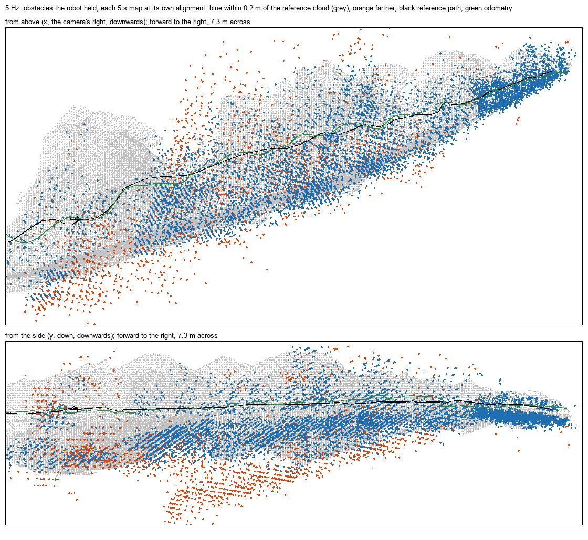
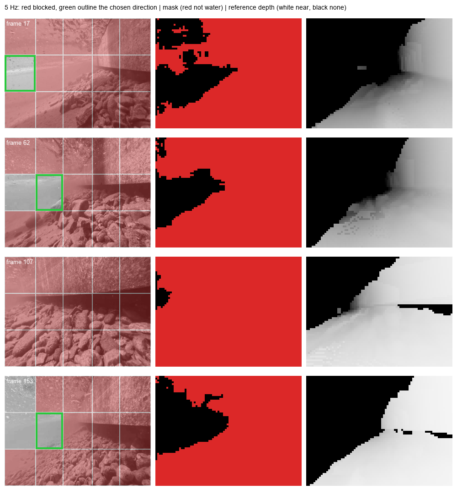
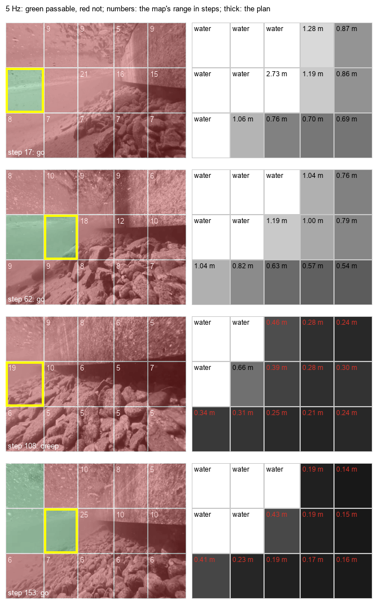

# uwslam

给小型水下机器人用的单目相机 SLAM：只用一个相机，不用 IMU，也不用超声波测距。一套 C 核心在电脑和 ESP32-P4 上逐位给出
相同结果：把机器人相机的灰度帧变成相机运动和一张持续累积的三维地图，把分割模型的水体掩码变成画面中哪些方向被挡住，
再由两者规划下一步往哪里走。所有结果都在一段湖中视频上对照它的三维重建检验过，并通过 USB 把视频流式送到 ESP32-P4 上
检验过。

[English](README.md)

```text
相机帧，320×240 灰度
├── core/mono_vo        角点、Lucas-Kanade 跟踪、相机运动、三角化得到稀疏三维点
│   └── core/voxel_map      把这些点持续累积成三维体素地图，跟丢时也不停 ──────┐
│                                                                            ├─ core/path_plan
└── 分割模型（ESP-DL，不在本仓库）：60×80 水体 / 非水体掩码                   │  避障与三维路径选择：
    └── core/obstacle_dir   判断画面中哪些方向被挡住，以及离正前方最近的空方向 ┘  下一步往哪里走
```

旁边还保留两张旧地图：[core/mono_map](core/mono_map.h) 是俯视的障碍切片，[core/mono_cloud](core/mono_cloud.h) 是跟踪
特征的稀疏点。两者在第一次跟丢时都会冻结。

## 结论

所有数字都来自湖中片段：一段沿湖中墙壁拍摄的水下视频的前 33.8 秒，30 FPS。参照是它的 WaterSplat 重建：88 个相机位姿
（时间戳乘 3，再晚一帧视频，见 [mask_motion](results/lake_clip/mask_motion/RESULTS.md)）和它的点云，单位按米计。水体
掩码是分割模型在机器人相机的 160×120 帧上的输出。中位数取自 16 个 RANSAC 随机种子，因为在这段视频上仅种子就能让误差
相差一倍。下文与早先设定的比较，是在参照挪后这一帧之前打的分；这一帧让各项得分的位置变化不到 1 毫米，航向中位数变化
不到 1°，规划的比例变化约一个百分点。

1. **视觉里程计在板子的帧率下能跟住整段视频。** C 版本的相机轨迹做一次相似变换对齐后，在相机游过的 8.9 米里，
   10 Hz 的均方根误差是 0.33 米，5 Hz 是 0.19 米，3 Hz 是 0.38 米。它所移植的 OpenCV 原型（仍用针孔相机）在一个种子上
   是 0.41、0.44 和 0.33 米。跟丢的步数分别是 2、13 和 17。单目尺度会漂移：5 秒窗口里最大与最小的尺度比是 5.3、1.8
   和 4.1 倍。C 工具的运行用上了相机的镜头，它的畸变不在画面中心：不用它时，每一步都会往上多俯仰一点。
2. **三维地图贯穿整段视频。** 体素地图保留的是机器人周围需要的部分：每隔 5 秒看它当时保留的障碍，到重建表面的距离中位数
   在 10 Hz 是 5.5 厘米、5 Hz 是 6.7 厘米，分别有 85% 和 76% 在 0.2 米以内。这是把最近 5 秒的轨迹对齐到参照后的结果；
   把整条漂移的轨迹一次对齐，结束时保留的障碍到表面的距离中位数是 0.05 米和 0.07 米。每次跟丢它都继续工作，而旧地图在
   第一次跟丢时冻结，33.8 秒里只覆盖了前 4.2–4.4 秒。
3. **水体掩码能可靠地判断被挡住的方向。** 当重建在 0.5、1 或 2 米内有表面占满 15 个方向之一的一半时，掩码在每个带里
   都至少有 99% 的情况也把这个方向判为被挡。5 Hz 下，它选出的空方向在这三个距离上分别有 100%、100% 和 99% 的时间
   确实是空的；而正前方只有 87%、61% 和 20% 的时间是空的，随机一个方向是 64%、40% 和 36%。掩码也会把上方的水面判为
   被挡，而重建里没有水面。
4. **规划器往空的水里走，并且知道还有多远。** 5 Hz 下前进时，它选的通道有 97% 在 0.5 米以外才有障碍，93% 在 1 米
   以外，从没有选过 0.25 米内就被挡的通道；而正前方只有 51% 在 1 米以外才有障碍。掩码找不到空方向时（3–4% 的步数，
   正对着墙），它慢慢挪进地图所知的空水里，而不是没有答案。它按机器人自身速度的步数计的距离，对地图知道距离的方向，
   有 86%（5 Hz）和 82%（10 Hz）与参照相差在两倍以内。掩码判为水的方向上地图没有点，所以规划改用画面中可见表面来给
   这些方向一个下限：5 Hz 下中位数 9.5 步（10 Hz 下 15.3 步），参照比这个下限更近的水体方向最多 1%。
5. **ESP32-P4 给出与电脑相同的结果，并能跑 5 Hz。** 以 5 Hz 和 10 Hz 把视频送到板子上，每一步里程计、体素地图、障碍
   方向、规划和障碍切片都与电脑逐位相同。360 MHz 双核时，5 Hz 每步 127 毫秒（中位数 132，最长 155）；体素地图另加
   0.48 毫秒，障碍方向 0.18 毫秒，规划 1.78 毫秒，在两帧间隔 200 毫秒以内。10 Hz 每步 102 毫秒（中位数 99，最长
   163），338 步里有 158 步超过两帧间隔 100 毫秒。结束时内部 RAM 还剩 107,928 B。

## 仓库结构

```text
.
├── core/                       C99，不用堆，不用 libm
│   ├── mono_vo*.c, mono_vo.h   单目视觉里程计（五个单元，见 mono_vo_internal.h）
│   ├── voxel_map.c/.h          持续累积的三维体素地图
│   ├── obstacle_dir.c/.h       由水体掩码判断被挡住的方向
│   ├── path_plan.c/.h          下一步往哪里走：局部避障与三维路径选择
│   ├── mono_map.c/.h           俯视障碍切片（第一次跟丢时冻结）
│   └── mono_cloud.c/.h         跟踪特征的稀疏点（第一次跟丢时冻结）
├── firmware/mono_vo_stream/    ESP32-P4 的 ESP-IDF 程序：在送来的帧和掩码上运行核心，回报哈希和耗时
├── src/uwslam/                 Python 包
│   ├── mvo.py                  核心的 ctypes 绑定；里程计在湖中片段上与 OpenCV 原型对照
│   ├── voxel_map.py            体素地图在湖中片段上对照重建打分
│   ├── obstacle_dir.py         方向判断在湖中片段上对照重建深度打分
│   ├── path_plan.py            规划在湖中片段上对照重建的空通道打分
│   ├── mono_map.py, mono_cloud.py   旧地图
│   ├── mvo_stream.py           把帧和掩码送到板子上，逐步对照电脑的结果
│   └── experiments/            OpenCV 原型（mono_vo）、参照位姿和掩码（mask_motion）、分割模型运行器（segmenter）
├── tests/                      unittest 测试；tests/c/ 放 C 契约检查和固件主机测试
└── results/lake_clip/          结果，每个工具一个文件夹，各有 RESULTS.md；也放板子的期望文件和运行记录
```

## 开始使用

需要 Python 3.10 或更新版本，PATH 上要有 gcc（Windows 上用 MinGW-w64）：C 核心会现场编译成共享库。所有命令都在仓库根
目录运行。

```bash
pip install -e ".[experiments]"             # numpy、Pillow、OpenCV（torch 和 esp-ppq 只有分割模型需要）
python -m unittest discover -s tests -t .
```

湖中视频和它的重建不在仓库里。工具需要视频和一个重建文件夹，里面有 `images.txt`（相机位姿，TUM 格式）和 `images.ply`
（点云）。每个工具都拒绝覆盖已有输出，请选一个新文件夹。

```bash
python -m uwslam.mvo compare <视频> --reconstruction <文件夹> --output results/lake_clip/mono_vo_c_2 --board-frames <帧文件>
python -m uwslam.voxel_map <视频> --reconstruction <文件夹> --output results/lake_clip/voxel_map_2
python -m uwslam.obstacle_dir <视频> --reconstruction <文件夹> --output results/lake_clip/obstacle_dir_2
python -m uwslam.path_plan <视频> --reconstruction <文件夹> --output results/lake_clip/path_plan_2
python -m uwslam.mono_map <视频> --reconstruction <文件夹> --output results/lake_clip/mono_map_2 --board-masks <掩码文件>
```

水体掩码由 [mask_motion](src/uwslam/experiments/mask_motion.py) 生成，它在视频上运行导出的 ESP-DL int8 分割模型
（模型文件夹的格式见 [segmenter.py](src/uwslam/experiments/segmenter.py)）。

Python 代码用 ruff 格式化和检查，配置在 [pyproject.toml](pyproject.toml) 里：`ruff format src tests` 和
`ruff check src tests`。

## 单目视觉里程计

[core/mono_vo.h](core/mono_vo.h) 用定点金字塔 Lucas-Kanade 和前后向检查，在 19×19 的窗口里跟踪最多 300 个 Shi-Tomasi
角点。如果跟踪符合纯转动（单应在 1 像素内），这一步就是这个转动；否则由八点 MSAC 本质矩阵、平移方向搜索和稳健的
Levenberg-Marquardt 给出运动，除非单独拟合的转动同样能解释这些跟踪。快速转弯时会把结果往单应的转角拉。只有证据支持
平移时才接受平移。步长来自相邻两步共有点的深度比（只算新一对帧放在 60 倍基线以内的点），并限制在近期速度的三倍以内。
内点太少的一步记为 LOST：位置不变，只取能测到的转动；若它的深度与之前的点一致，就把尺度接下去。C 版本在设计上沿用
OpenCV 原型（[experiments/mono_vo.py](src/uwslam/experiments/mono_vo.py)），数值实现是自己的；两者的对照见
[results/lake_clip/mono_vo_c/RESULTS.md](results/lake_clip/mono_vo_c/RESULTS.md)，原型本身的结果见
[results/lake_clip/mono_vo/RESULTS.md](results/lake_clip/mono_vo/RESULTS.md)。

| 帧率 | 对齐后位置均方根误差 | 航向均方根误差 | 5 秒窗口尺度比的跨度 | 跟丢步数 |
|---:|---:|---:|---:|---:|
| 10 Hz | 0.33 m [0.26–0.37] | 39.5° [30–46] | 5.3× [2.3–9.2] | 2 [1–4] |
| 5 Hz | 0.19 m [0.16–0.26] | 19.4° [5–26] | 1.8× [1.4–2.6] | 13 [11–15] |
| 3 Hz | 0.38 m [0.34–0.56] | 39.1° [26–66] | 4.1× [1.6–8.1] | 17 [16–19] |

16 个种子的中位数 [最小–最大]。单目没有公制尺度，尺度由对齐给出。

这些设定偏向板子的输入帧率 5 Hz，把 P4 的算力花在它上面。当时用针孔相机，300 个特征点而不是 250 个，让 5 Hz 轨迹的
误差在 16 个种子的中位数上从 0.33 米降到 0.26 米，在片段的 10 秒窗口上从 0.079 米降到 0.067 米（192 对配对运行里 68%
更低），航向不变；10 Hz 下反而更差。其他几种用这份算力换精度的办法都没有用：640×480 画面、10 Hz 输入、更多 RANSAC
采样、更多次优化或跟踪迭代。用上湖中片段的镜头后，19×19 窗口而不是 15×15，让 5 Hz 窗口上的航向中位数从 8.1° 降到
6.2°（59% 的配对运行更低），最大误差从 20.1° 降到 15.3°，位置差不多（0.066 米对 0.067 米，57% 更低）；3 Hz 和
10 Hz 下航向变差。在 19×19 窗口上再用 350 或 400 个特征点，5 Hz 反而更差（整段 0.23 和 0.24 米，对比 0.21 米）。
往单应转角的拉力修好了 5 Hz 下的快速摆动：那里本质矩阵把每个快速步的最多四分之一当成了平移（片段里那次两秒的摆动共
14°）；10 Hz 下步子只有一半大，拉力修好摆动前半段多于后半段，整段的航向反而比不拉时差。

快速转弯时跟丢的一步，只要至少 8 个跟踪、且其中一半认同同一个转动，就保留这个转动（5 Hz 下跟丢的步转角中位数是 11°，
若保持上一位姿，这些转角全都会从航向里丢掉）：取单独拟合的转动；只有单应得到这种支持时，若本质矩阵位姿有 15 个内点
就取它的转动，否则取单应的。单独拟合的转动不认同的单应，多半是把平移造成的视差当成了转动，在湖底上方就成了俯仰：
5 Hz 下这样跟丢的步，单应每步的俯仰误差是 +1.5°，本质矩阵的位姿是 −0.2°，两者总误差差不多（6.0° 和 6.2°），但这个
偏差让轨迹爬高。没有任何转动得到支持的 LOST 步仍然不取转动：对跟踪噪声大的静止相机，取本质矩阵的转动会凭空加出并不
存在的转动。

跟踪相对于转动给不出平移的证据时就不取平移，LOST 步也不取平移。这些步的代价是尺度：LOST 步会丢掉把步长从一步传到
下一步的三角化点，于是下一步每次都从近期速度重新开始。所以本质矩阵位姿有 15 个内点的 LOST 步，只要它与之前的点共有的
深度比里至少有 8 个在同一个尺度上一致（四分位距不超过中位数的一半），就用这个位姿把点接下去，仍然不取平移。静止相机的
噪声拟合出的位姿深度比很分散，所以几乎总是丢掉这些点。

湖中相机的畸变在高度方向上不居中：一阶近似下是 OpenCV 模型里 −0.02 的切向项 p1，就像画面是从偏离镜头光轴的位置裁出来
的；不用它时，每一步都会往上多俯仰一点。它是不靠参照、只用核心自己的跟踪找到的：用上这一项，30 FPS 逐帧的步串起来的
俯仰，与在同样的跟踪上跨 1.6 秒直接估计的转动一致，浮码头笔直的下边缘在整段视频里也保持同一个消失点。所以 C 工具在
湖中片段上的运行用这个镜头（[experiments/mono_vo.py](src/uwslam/experiments/mono_vo.py) 里的 `LENS`；OpenCV 原型仍用
针孔）。

5 Hz 下剩下的主要是尺度，不是旋转：用每次运行自己的各步重建路径（16 个种子，在加下面的 60 倍基线限制之前），换上参照的姿态时
整段位置误差是 0.200 米，换上参照的步长时是 0.140 米，而原样是 0.214 米。尺度本身有偏差。步长是各共有点的旧深度与它在
新一对帧里的深度之比的中位数，原来只算新一对帧放在 50 倍基线以内的点（`MVO_MAX_DEPTH`）。这个比值随新一对帧的视差增大
而增大，所以按这对帧自己带噪声的深度截断，会去掉噪声把它推远的点；步子短时很多点正落在这个界限附近，中位数就有偏差。
现在算的是新一对帧放在 60 倍基线以内的点（[core/mono_vo.h](core/mono_vo.h) 里的 `MVO_RATIO_DEPTH`），对照之前的 50 倍
（16 个种子）：

| | 50 倍基线以内 | 60 倍基线以内 |
|---|---:|---:|
| 5 Hz，整段：位置 RMSE / 尺度跨度 | 0.214 m [0.148–0.275] / 2.0× | 0.190 m [0.157–0.257] / 1.8× |
| 10 Hz，整段：位置 RMSE / 尺度跨度 | 0.394 m [0.359–0.434] / 8.3× | 0.327 m [0.257–0.366] / 5.3× |
| 5 Hz，10 秒窗口：位置 RMSE 中位数 | 0.066 m | 0.064 m（66% 更低） |
| 10 Hz，10 秒窗口：位置 RMSE 中位数 | 0.088 m | 0.076 m（47% 更低） |
| 5 Hz 体素地图：局部 / 整体距离中位数 | 0.065 / 0.072 m | 0.068 / 0.070 m |
| 10 Hz 体素地图：局部 / 整体距离中位数 | 0.057 / 0.055 m | 0.055 / 0.045 m |
| 5 Hz 规划：所选方向的已知距离落在参照两倍以内的比例 | 71% | 81% |

航向和跟丢的步都不变。规划那一行依据的步很少：默认种子下 169 步里只有 12 步所选方向有已知距离（之前 14 步）。60 是在
这一段视频上从 50、60、75、100 倍基线和不设界限中选出的，应该在机器人自己拍的视频上再验证。界限放得更宽时，5 Hz 的
路径还能更好（100 倍基线时 0.173 米），但局部地图更差（0.076 米），10 Hz 的窗口也更差（0.105 米）；完全不设界限时，
噪声大到没用的点让 10 Hz 变差。

针对尺度试过但放弃了的：镜头的第二个偏心项（p2 取 −0.02 或 −0.03；30 FPS 的链式各步相对直接估计的偏航在 −0.03 时缩到
接近零）让整段的航向变好（19.0° 降到 13.4° 和 12.7°），但 10 秒窗口的航向没有变好，尺度也变差：5 Hz 整段位置误差变成
0.34–0.38 米，而不是 0.21 米。在电脑上做的最近五帧滑窗拟合（拟合位姿、位置或步长，连同跟踪经过这些帧的点）让尺度
塌缩：5 Hz 下每步只有 49% 的跟踪能延续到下一帧，延续两步的约三分之一，跟踪这么短时，滑窗的尺度比里程计的链漂得更
厉害；10 Hz 下跟踪活得更久，结果却是 1.0–1.3 米，对比 0.39 米（4 个种子）。用邻近点的位移重新跟踪丢掉的特征点，跟丢的
步从 13 减到 11，但 5 Hz 整段变成 0.38 米（两次都从同一个猜测出发，前后向检查对错误的跟踪也会一致），再加上新角点离
边缘至少 12 像素也一样。把每步步长往上一步拉得到 0.24–0.37 米（潜水员的速度会变，比值带着这个信息），让共有点重投影
最好的步长是 0.55 米，按旧深度的倒数加权的中位数是 0.24 米。跟踪短主要是因为新角点死得快：刚检测出来的角点只有 29%
能延续一步，跟踪了四步以上的有 80%。

相机由 `mvo_camera_t` 描述：320×240 帧的针孔内参，加上 OpenCV 模型和顺序的镜头畸变 k1、k2、p1、p2、k3，即
`cv2.calibrateCamera` 在 320×240 下标定给出的值。机器人的相机要在水下、隔着防水罩标定：水和平面窗都会改变镜头。每一步的
点对在进入任何模型之前先去畸变（牛顿迭代，在测试里与 OpenCV 的去畸变相差不到 0.001 像素）；角点、跟踪和掩码仍在原始
图像上，障碍方向用掩码每一列、每一行去畸变后的视线。五个系数全为零时什么都不变：核心与针孔版逐位相同。湖中视频的镜头
从没标定过；C 工具在它上面的运行只用视频本身显示出的那一项 p1 = −0.02（见上文），主机把它和相机的其余参数一起发给
板子。测试里把一个运动的相机用强桶形畸变镜头渲染：告诉里程计镜头时，它保持针孔相机时的精度；把同样的帧当成针孔相机时，
转角和移动方向的误差都大得多。Python 里用 `mvo.Camera(fx, fy, cx, cy, k1, k2, p1, p2, k3)`（`mvo.clip_camera()` 是湖中
片段的相机），或 `python -m uwslam.mono_cloud <video> --fx … --k1 … --k3 …`；板子的 `start` 行在种子、核数和 simd 之后
带上这五个系数。

## 持续累积的体素地图

[core/voxel_map.h](core/voxel_map.h) 在每一步里程计之后，把三角化质量好、且掩码判为非水体的跟踪点，按体素累积到里程计
的坐标系里。遇到 LOST 也不停，因为里程计在跟丢时保持自己的坐标系。单目尺度会漂移，所以体素边长跟着场景走：取中位深度的
十六分之一；当场景要求的边长变成两倍或一半时就重设边长，原有体素按中心重新编号并合并。被两帧看到的体素算障碍；没观测过的
空间是未知，不是空。地图最多保留 4096 个体素（56 KB），满了以后先丢远处的，再丢只见过一次的，最后丢最久没见的障碍。
在湖中片段上以 5 Hz 运行时，它保留的障碍是最近 5.7 秒内见过的（中位数；90% 在 12.8 秒内）。

| 帧率 | 局部：距离中位数 | 局部：0.1 / 0.2 米以内 | 全局：距离中位数 | 保留的障碍 | 经过的 LOST 步数 |
|---:|---:|---:|---:|---:|---:|
| 10 Hz | 0.055 m [0.046–0.063] | 68% / 85% | 0.05 m [0.04–0.08] | 2078 | 2 |
| 5 Hz | 0.067 m [0.061–0.085] | 60% / 76% | 0.07 m [0.05–0.11] | 1068 | 13 |

局部：每隔 5 秒，取机器人当时保留的障碍，把它最近 5 秒的轨迹对齐到参照（这正是避障要用的）。全局：结束时保留的障碍，
整条轨迹一次对齐。细节和图见 [results/lake_clip/voxel_map/RESULTS.md](results/lake_clip/voxel_map/RESULTS.md)。



体素这么细、这么多，是因为 P4 有这份内存。和边长大一倍、数量只有四分之一的体素相比（在 15×15 窗口的里程计上评分），
5 Hz 下保留的障碍在整条路径上离参照表面 0.074 米而不是 0.106 米，相机附近 0.064 米而不是 0.067 米（10 Hz 下 0.055 和
0.050 米，而不是 0.075 和 0.060 米）；而大体素的更大地图当时没有用。只见过一次的点更容易落进不同的细体素，所以规划按
每边两个体素合成一格来读（见下文）。

多出来的特征点三角化得没那么准，地图上的点离参照稍远一些：当时用针孔相机，300 个特征点让 5 Hz 地图的局部误差是
7.1 厘米而不是 6.1 厘米。建图只收视线夹角至少 1.5° 的点（而不是 1°）能把误差拉回来，但正前方距离已知的比例减了一半
（5 Hz 下 34% 对 71%），因为向前运动时那里的视差最小：合成测试里径直开向一堵墙时，11 步里一步也不知道正前方的距离
（1° 时是 7 步），1.25° 也一样。所以各张地图都按 1° 建图。

## 障碍方向

[core/obstacle_dir.h](core/obstacle_dir.h) 把每帧 60×80 的掩码分成画面的 3 × 5 个方向：上、平、下三个带以 ±15° 为界，
五个扇区以离光轴 ±15° 和 ±40° 为界。一个方向只要一半不是水就立刻判为被挡，要连续两帧低于 30% 才放开。选择的是离正前方
最近的空方向：先看步数，再优先转向而不是上浮或下潜，最后选更空的那个。打分时用同一个网格、从每帧的参照相机看重建。
各带、各距离的表格见 [results/lake_clip/obstacle_dir/RESULTS.md](results/lake_clip/obstacle_dir/RESULTS.md)。



掩码只给方向不给距离，而且“上”是画面的上，不是重力的上。距离由体素地图给出，规划器把两者合起来。

## 避障与路径选择

[core/path_plan.h](core/path_plan.h) 在每一步之后决定往哪里走：在同样的 3 × 5 个方向里，朝一个目标方向（默认正前方，
也可以由调用者给出里程计世界坐标里的方向）。单目没有尺度，所以距离按步数计：里程计的近期速度就是一步，n 步远就是按这个
速度 n 帧以后到。一个方向的距离取其中第二近的障碍（只有一个太容易是错点）。一个方向可走，要求掩码判它为水，并且地图在
8 步（5 Hz 下 1.6 秒）内没有障碍。地图只能加否决，不能解除否决：它只记有纹理的点，地图里没有点的地方，掩码仍可能看到
表面。如果允许地图的远距离解除掩码的否决，规划会在 2–4% 的步数里走进 0.25 米内就被挡的通道；不允许时一次也没有。规划选
离目标最近的可走方向，优先转向而不是上浮或下潜。没有可走方向时，慢慢挪进地图所知最长的空水（至少 3 步），否则原地转向
地图障碍较少的一侧；什么都不知道时停下。

打分是开环的（相机跟的是潜水员的路线，不是规划的路线），对照的是重建里每个方向的空通道：该方向中间一半格子的距离取
第 10 百分位。

| 5 Hz，16 个种子 | 0.25 米外才有障碍 | 0.5 米外才有障碍 | 1 米外才有障碍 |
|---|---:|---:|---:|
| 规划，前进（96% 的步数） | 100% | 97% | 93% |
| 规划，慢挪（4% 的步数，掩码找不到空方向时） | 100% | 83% | 75% |
| 正前方 | 92% | 86% | 51% |
| 事后看最好的方向 | 100% | 100% | 100% |

前进时，它选的通道和掩码自己的选择一样空（100%、97% 和 93%）。默认种子下，地图在掩码判为水的方向上做出否决的步，5 Hz
有 5 步，10 Hz 有 3 步（10 Hz 下有一次否决的正是掩码自己的选择），而这些否决里参照在 8 步内有表面的一个也没有。这不是
地图的毛病：在掩码判为水的方向上，参照里没有一个在 8 步内有表面，本来就没有可否决的东西。地图在那里也几乎没有点：体素
地图不收水体格子上的点，开阔水体也没有可跟踪的纹理。地图在水体方向上做出的少数否决都来自零散的错点。

所以规划改为给水体方向一个下限。沿水体方向的视线上，比能见距离更近的东西本身会被看见，而画面里每个可见表面都比能见距离
近，所以水体方向至少空到相机此刻看到的表面那么远。`clear` 取本帧收进的体素距离中位数的 0.75 倍（至少要有 10 个）。
16 个种子下，它对 82%（5 Hz）和 92%（10 Hz）的水体方向有值，中位数 9.5 步和 15.3 步（超过 8 步安全距离的分别占 70% 和
98%），参照比它更近的在 5 Hz 下最多 1%，10 Hz 下没有。初步试验里，这些例外仍有 14 步以上的空水；若直接用中位数作下限，
例外是 1.4%。地图带来的是掩码没有答案时的答案，以及距离（包括这个下限）：机器人可以在离最近障碍的步数变少时减速。

规划按每边两个细体素合成一格来读（`PP_GROUP`），并把这些体素的帧数相加，所以两个各只见过一次的体素（即使在同一帧里）
也会让所在的格子成为障碍。用 15×15 窗口时，逐个读细体素，5 Hz 下正前方距离已知的步数只有 68% 而不是 77%；合成一格来读
则是 83%，选的方向前方的空水一样多，已知距离落在参照两倍以内的比例是 87% 而不是 90%。现在的版本在 5 Hz 下 83% 的步数、
10 Hz 下 52% 的步数知道正前方的距离。10 Hz 的结果见
[results/lake_clip/path_plan/RESULTS.md](results/lake_clip/path_plan/RESULTS.md)。



## ESP32-P4

[firmware/mono_vo_stream](firmware/mono_vo_stream) 在 ESP32-P4（两个 RISC-V 核，360 MHz，不用 PSRAM）上，对电脑送来的
帧和掩码运行里程计、体素地图、障碍方向、规划器和两张旧地图，每帧回报这一步的哈希、地图计数和各阶段耗时。
[mvo_stream.py](src/uwslam/mvo_stream.py) 把这些逐项对照电脑的结果。板子在 `ready` 行里报出自己的编译名 `p4` 和编译时
所用源码的哈希；主机拒绝用别的源码编译的板子，也拒绝别的编译做出的期望文件。

链路就是控制台。默认（[sdkconfig.defaults](firmware/mono_vo_stream/sdkconfig.defaults)）是 UART0，P4 板子通过 USB 转
串口芯片把它引出来；固件启动后把它切到 921,600 波特（主机用 `--baud` 指定）。在 2 Mbaud 下，CH340 转串口在三次湖中运行
里有两次丢了板子回复里的单个字节，所以主机也会拒收残缺的 step 行。若接芯片自己的 USB-Serial-JTAG 口，就在默认配置后加上
[sdkconfig.usb_serial_jtag](firmware/mono_vo_stream/sdkconfig.usb_serial_jtag)，用单独的编译目录；只有控制台不同。

```bash
# 在 ESP-IDF 5.3+ 的命令行里；控制台走 USB 转串口：
idf.py -C firmware/mono_vo_stream -B firmware/mono_vo_stream/build -D SDKCONFIG=build/sdkconfig -p <端口> flash
# 或者走芯片自己的 USB-Serial-JTAG 口：
idf.py -C firmware/mono_vo_stream -B firmware/mono_vo_stream/build_usj -D SDKCONFIG=build_usj/sdkconfig \
    -D "SDKCONFIG_DEFAULTS=sdkconfig.defaults;sdkconfig.usb_serial_jtag" -p <端口> flash

python -m uwslam.mvo_stream --port <端口> --frames <帧文件> --masks <掩码文件> \
    --expected results/lake_clip/mono_vo_c/board_expected_5hz.json \
    --expected-map results/lake_clip/mono_map/board_expected_map_5hz.json \
    --expected-voxels results/lake_clip/voxel_map/board_expected_voxels_5hz.json \
    --expected-dirs results/lake_clip/obstacle_dir/board_expected_dirs_5hz.json \
    --expected-plan results/lake_clip/path_plan/board_expected_plan_5hz.json --label <名字>
```

帧文件由 `uwslam.mvo compare --board-frames` 写出，掩码文件由 `uwslam.mono_map --board-masks` 写出；用 5 Hz 的期望文件
时，板子每两帧收一帧。主机只需要 pyserial（`pip install -e ".[board]"`，或者用 ESP-IDF 自带的 Python）。每次送流之前，
主机让板子在 2,000 个随机窗口上把向量内核与可移植的 C 内核对照一遍（`selftest`），有任何不同就拒绝这块板子。

[mvo_vector.S](firmware/mono_vo_stream/main/mvo_vector.S) 是跟踪器的窗口内核，用 P4 的向量指令写成：19×19 窗口的一行
占三个向量（每个八条 16 位通道），结果与 C 内核的整数完全相同。每次调用 19.6 微秒（窗口）和 6.5 微秒（求和），P4 上的
C 内核是 118 和 36 微秒；块拷贝仍用 C（每次 8 微秒）。

用湖中片段的镜头、经 USB-Serial-JTAG 口测得（[results/lake_clip/mono_vo_c/board](results/lake_clip/mono_vo_c/board) 里的
记录 `p4_360mhz_usj*`）：

| | 5 Hz（169 步） | 10 Hz（338 步） |
|---|---:|---:|
| 每步、体素地图、障碍方向、规划和障碍切片与电脑相同 | 全部 | 全部 |
| 里程计每步，平均 / 中位数 / 最长 | 127 / 132 / 155 ms | 102 / 99 / 163 ms |
| 跟踪 / 运动 / 角点检测，平均 | 86 / 26 / 16 ms | 66 / 28 / 8 ms |
| 体素地图更新，平均 / 最长 | 0.48 / 2.6 ms | 0.55 / 4.1 ms |
| 障碍方向，平均 | 0.18 ms | 0.18 ms |
| 规划，平均 / 最长 | 1.78 / 3.0 ms | 1.83 / 2.9 ms |
| 结束时剩余内部 RAM | 107,928 B | 107,928 B |

5 Hz 每步都在两帧间隔 200 毫秒以内；10 Hz 下 338 步里有 158 步超过两帧间隔 100 毫秒。所有数据都在内部 RAM 里：两帧的
图像金字塔（各约 100 KB）、里程计状态和体素地图（56 KB）。这些是板上的计算时间：回放的速度由链路决定（经 USB-Serial-JTAG
口，5 Hz 片段的 170 帧用了 38 秒），也不含分割模型。

## 局限

- 只有一段视频，是潜水员拍的而不是机器人，参照本身也有误差；相机 110° 的视场是在同一段视频上拟合的，这只能把它定到
  十度左右的范围（参照挪后一帧后，拟合偏向更窄的视场；在 C 里程计里，更窄的视场在 5 Hz 和 10 Hz 的多数指标上航向更好，
  但 5 Hz 的位置更差），镜头也从没标定过：C 工具在湖中片段上的运行只用视频本身显示出的偏心项（p1 = −0.02）。步长取点的 60
  倍基线等设定也只在这一段视频上选过。
- 只有一个相机：没有公制尺度，里程计会漂移，尤其是尺度。地图不做回环，跟丢后也不重新定位。
- 掩码的方向是相机的方向，不与重力对齐；掩码判断不了距离。
- 规划器是局部的，打分是在一段并非由机器人驾驶的视频上开环进行的：它还没有真正驾驶过机器人。
- 板上检验是通过串行链路送录好的帧和掩码，不包括图像采集、分割模型和机器人的其他任务。
